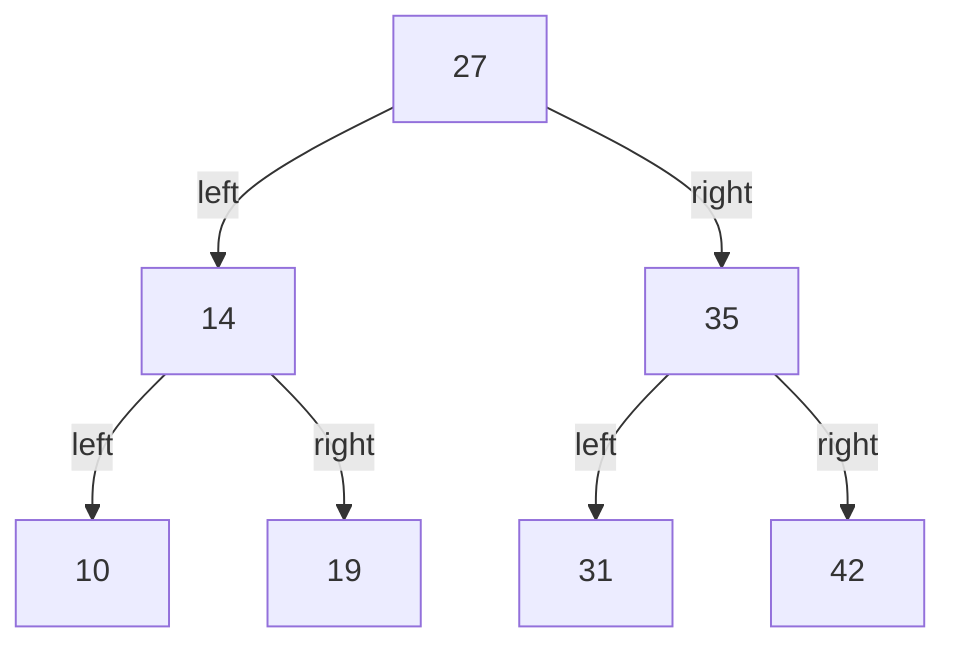
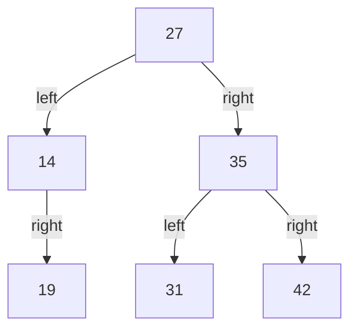
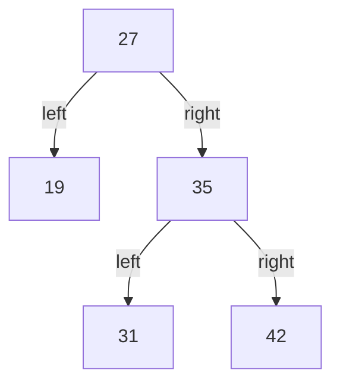
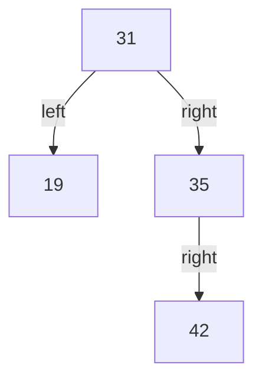

# HW8 Bonus - bst_remove
For the bonus, I added bst_remove() so the tree can remove one number at a time. It returns 0 if the number was removed. If the tree is NULL or the number is not there, it returns -1 and does not change anything. There are three ways a number can be removed. If the node has no children, I can just remove it. If it has one child, that child takes its place. If it has two children, I replace its number with the smallest number on the right side and remove the old node that held that number. Only one node is freed each time. I tested it using the original seven numbers: 27, 14, 35, 10, 19, 31, and 42.

## Starting tree

## 1. Remove 10
10 is at the bottom with no children, so it is the easiest one to remove. There are 6 nodes left.

## 2. Remove 14
After 10 is gone, 14 only has one child, which is 19. I connect 19 straight to 27, where 14 used to be. There are 5 nodes left.

## 3. Remove 27
This one is a little harder because 27 has two children. The smallest number in its right subtree is 31, so 31 replaces 27 at the root. Then the old 31 node is removed. There are 4 nodes left.

## Tests
I used tests/test_remove.c to check these three cases. The tests also check what happens with duplicate numbers, a missing number, a NULL tree, and a replacement node that has its own child.

I ran the bonus tests with:

`make bonus`

All the bonus tests passed.